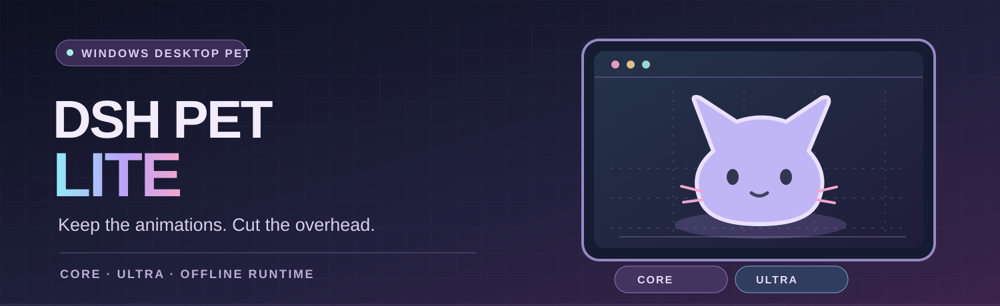
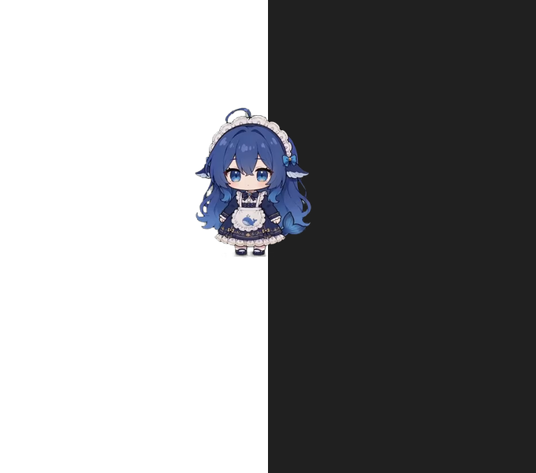

<h1 align="center">🐾 DSH Pet Lite</h1>

  
   
  ORIGINAL SYMBOLIC COVER · REAL CHARACTER SCREENSHOT AND RIGHTS INFORMATION BELOW

<strong>Keep the animations. Cut the overhead.</strong>

An independent, offline, lightweight Windows desktop pet. 
Rebuilt from <a href="https://github.com/MerZlin/dsh-pet-indesktop">dsh-pet-indesktop</a> — focused on the character, not the feature bloat.

  
  
  
  

  <a href="https://github.com/seiya058904/DSH-Pet-Lite/releases/download/v1.0.1/DSH-Pet-Lite-Core-v1.0.1-win-x64-portable.zip"><strong>⬇ Download Core · 117.02 MB</strong></a>
  &nbsp; | &nbsp;
  <a href="https://github.com/seiya058904/DSH-Pet-Lite/releases/download/v1.0.1/DSH-Pet-Lite-Ultra-v1.0.1-win-x64-portable.zip"><strong>⬇ Download Ultra · 50.24 MB</strong></a>

   
  Core in a real Windows test session at 100% scaling. Character attribution and non-commercial terms apply.

---

## ⚡ Optimization results at a glance

**Core keeps every one of the original basic animations while dramatically reducing the download and installed footprint.**

| 📦 **66.5% smaller download** | 💾 **73.8% less disk space** | 🎞️ **11/11 core clips preserved** |
|:---:|:---:|:---:|
| **348.97 → 117.02 MB** | **576.93 → 151.40 MB** | **2,651 / 2,651 frames** |
| Official v4.4.0 base ZIP → Core v1.0.1 | Unpacked official base → Core v1.0.1 | Original **24 fps** logical timeline |

> **Fair comparison:** the audited official **base package** contains **11** animations; the other **95** are optional extra packs. Core Lite also ships **11**. They do **not** have identical application features or original-pixel dimensions: Lite uses lossless, tightly cropped frames at its supported 72%-scale presentation. The percentages above describe **package and disk size**, not proven CPU or power savings.

### What v1.0.1 improved over v1.0.0

| Edition | Download ZIP | Unpacked size | Improvement without sacrificing frames |
|---|---:|---:|---|
| **Core** · 11 clips, 2,651 frames | 123.40 → **117.02 MB** | 161.13 → **151.40 MB** | **−5.17% ZIP**, **−6.0% unpacked** |
| **Ultra** · 3 clips, 723 frames | 53.57 → **50.24 MB** | 91.57 → **84.86 MB** | **−6.21% ZIP**, **−7.3% unpacked** |

The final round introduced **exact-byte frame deduplication** (120 duplicated physical frames removed from Core, 37 from Ultra) and excluded the unused **Python _hashlib / OpenSSL backend**. All logical frames, alpha, offsets, decoded pixels and playback timing remain unchanged.

[📊 Full performance report](docs/PERFORMANCE_REPORT.md) · [🧪 v1.0.1 test evidence](benchmarks/public/v1.0.1-exploration.json) · [Release validation](https://github.com/seiya058904/DSH-Pet-Lite/releases/download/v1.0.1/RELEASE-VALIDATION.json)

## 🔧 What's actually optimized?

This isn't the full app with its extra features merely switched off. **Its execution graph, rendering window and distribution were rebuilt for a single job: displaying an animated desktop pet.**

| Area | Lite's implementation | Practical benefit |
|---|---|---|
| **Window architecture** | One small transparent, always-on-top Qt window replaces a screen-sized overlay and complex pet-world controllers | No full-desktop overlay or multi-pet world to maintain |
| **Runtime dependencies** | Only Python standard library + Qt Core/Gui/Widgets | Physically excludes chat/LLM, Agent bridge, OCR, screenshots, TTS, audio, media, monitoring and updater stacks |
| **Animation scheduler** | Single deadline-aware **24 fps** frame timer; Core movement uses the same clock | Avoids additional motion polling and catch-up bursts |
| **Memory policy** | On-demand lossless WebP decoding; max **40 MiB** decoded idle cache; action frames aren't kept as a permanent library | No eagerly decoded full animation set in memory |
| **Invisible / paused states** | Pause stops frame scheduling; hide stops it and clears the decoded cache | Avoids continued animation work and releases frame cache when hidden |
| **Frame storage** | Byte-identical frames share a physical file, with every logical frame still addressable | Fewer shipped bytes; **no animation or frame removal** |
| **Smaller Qt/Python bundle** | Removes unneeded Qt plugins/translations and optional _hashlib/OpenSSL binaries | Less disk and download overhead; fewer bundled dependencies |
| **Background behavior** | No agent listener, global mouse hook, screen capture, network updater, service, scheduled task or auto-start | A self-contained pet with no extra resident helper stack |
| **Settings / resilience** | Small per-edition settings files, atomic writes on relevant user actions, single-instance protection | No continuous config-save loop; predictable startup and recovery |

These are **architectural and measured package improvements**, not a claim of zero CPU use. Experiments that didn't justify their cost — smaller decoded cache, extra compression passes, QPixmap substitution, lazy startup and a custom frame container — were rejected instead of adding complexity.

[Technical architecture](docs/EDITION_COMPARISON.md) · [Animation parity](docs/CORE_ANIMATION_PARITY.md) · [Benchmark methodology](docs/BENCHMARK_METHODOLOGY.md)

## 🐱 Choose your edition

| Feature | **Core Lite — expressive & lightweight** | **Ultra Lite — minimalist** |
|---|---|---|
| **Download** | **117.02 MB** | **50.24 MB** |
| **Unpacked** | 151.40 MB | 84.86 MB |
| **Animations** | **11** / 2,651 logical frames | **3** / 723 logical frames |
| **Interactions** | Idle, **5 click** reactions, drag, **3 move** animations, turn | Idle, click, drag |
| **Movement** | Bounded autonomous movement and turning | No roaming code or movement assets |
| **Frame timeline** | Original 24 fps | Original 24 fps |
| **Ideal for** | Daily desktop use with the full *official starter* animation set | Users who prefer the smallest possible edition |
| **Get it** | [**Download Core**](https://github.com/seiya058904/DSH-Pet-Lite/releases/download/v1.0.1/DSH-Pet-Lite-Core-v1.0.1-win-x64-portable.zip) | [**Download Ultra**](https://github.com/seiya058904/DSH-Pet-Lite/releases/download/v1.0.1/DSH-Pet-Lite-Ultra-v1.0.1-win-x64-portable.zip) |

**Core is the recommended default.** Both editions run independently — **no DeepSeek Harness, system Python, account, administrator rights or internet connection needed**. Both preserve transparent-pixel click-through, drag/click interaction, tray controls, show/hide, pause, quit, saved position and single-instance protection.

Ultra is truly a separate smaller package, **not** Core with hidden menu options. The old 106-clip Full build is a retired experiment, not a current release.

## 🪟 Install in three steps

1. Download [Core](https://github.com/seiya058904/DSH-Pet-Lite/releases/download/v1.0.1/DSH-Pet-Lite-Core-v1.0.1-win-x64-portable.zip) or [Ultra](https://github.com/seiya058904/DSH-Pet-Lite/releases/download/v1.0.1/DSH-Pet-Lite-Ultra-v1.0.1-win-x64-portable.zip).
2. Extract the **whole ZIP** into a normal folder; launch **DSH-Pet-Lite-Core.exe** or **DSH-Pet-Lite-Ultra.exe**.
3. Click the pet to react, drag it to reposition, right-click for animations and controls, or use the tray icon to pause, hide, restore and exit.

Run one edition at a time. The executable uses its accompanying bundled files — **do not extract or move only the EXE**. Neither edition adds a service or automatic startup.

[Install / update / uninstall guide](docs/INSTALL.md) · [SHA-256 checksums](https://github.com/seiya058904/DSH-Pet-Lite/releases/download/v1.0.1/SHA256SUMS.txt) · [Full release page](https://github.com/seiya058904/DSH-Pet-Lite/releases/tag/v1.0.1)

## 📐 Honest measurements and limitations

The available evidence supports a **substantial size reduction** and a **smaller, isolated runtime**, but it does not establish a statistically reliable CPU, GPU, power or first-paint speedup.

- In the final v1.0.1 local three-start runs, Core averaged roughly **50 MB Private Bytes / 75 MB Working Set**; Ultra roughly **49 MB / 73 MB**. They are observations, **not hard upper bounds**.
- The historical official-vs-Lite runtime measurements used different action schedules, so they **must not** be advertised as a controlled percentage CPU/memory improvement.
- Core passed **15 tests**; Ultra passed **14 tests, with 1 Core-only test intentionally skipped**. Final builds also underwent native Windows input, transparency, drag, tray, update/uninstall, manifest, ZIP and library-license checks.
- The 30+5+5-minute soak was **cancelled by the owner** and is **not a pass**. High DPI, 4K/multiple monitors, GPU/watts and physical monitor Present remain unverified; a sporadic input-probe anomaly was recorded. CPU time counters on the test host are unreliable.
- The EXEs are unsigned. The available reports include adverse results and exact artifact hashes rather than hiding them.

[Detailed results](docs/PERFORMANCE_REPORT.md) · [Raw benchmarks](https://github.com/seiya058904/DSH-Pet-Lite/releases/download/v1.0.1/BENCHMARKS-v1.0.1.zip) · [Release validation](https://github.com/seiya058904/DSH-Pet-Lite/releases/download/v1.0.1/RELEASE-VALIDATION.json) · [CI results](https://github.com/seiya058904/DSH-Pet-Lite/actions)

## 🧰 Source, reproducibility and credits

Windows x64 · Python 3.12 · PySide6 / Qt 6.12.0 · PyInstaller (portable, one-directory). Two builds share the source code while excluding each other's unnecessary assets. Source, checksums and build instructions remain online so you don't need to keep a local development checkout to use the pet.

[Build from source](docs/BUILD.md) · [Reproduce measurements](docs/BENCHMARK_METHODOLOGY.md) · [Changelog](CHANGELOG.md)

**This is an unofficial, non-commercial derivative — not an official release from DeepSeek or either upstream maintainer.**

- **Original desktop app:** [MerZlin/dsh-pet-indesktop](https://github.com/MerZlin/dsh-pet-indesktop), based on **v4.4.0**.
- **Animation and project origin:** [PC2005-cloud/dsh-pet](https://github.com/PC2005-cloud/dsh-pet).
- **Character:** OC **Mingyue**, attributed to **Shangshan Wuxing**, with animations prepared by the community. Names are romanized here; the [original-language attribution](ASSET_LICENSE.md) is preserved in the asset terms.
- **Code license:** MIT with original notices retained. **Artwork/animation terms are separate, attribution-bound and non-commercial — not MIT.**
- **Qt/PySide6/Shiboken:** the release includes corresponding source archives, license texts and information on replacement/debugging rights.

The project owner's stated non-commercial release authorization does not imply possession of an independently verified signed third-party license, and no precise Creative Commons version is invented.

[Asset terms](ASSET_LICENSE.md) · [LICENSE](LICENSE) · [Third-party notices](THIRD_PARTY_NOTICES.md) · [Qt source delivery](lite/licenses/SOURCE-DELIVERY.md)

---

<strong>Small enough to keep running. Simple enough to leave alone.</strong> 
<a href="https://github.com/seiya058904/DSH-Pet-Lite/releases/tag/v1.0.1">Stable v1.0.1</a> · <a href="docs/PERFORMANCE_REPORT.md">Verified data</a> · <a href="https://github.com/MerZlin/dsh-pet-indesktop">Original project</a>

